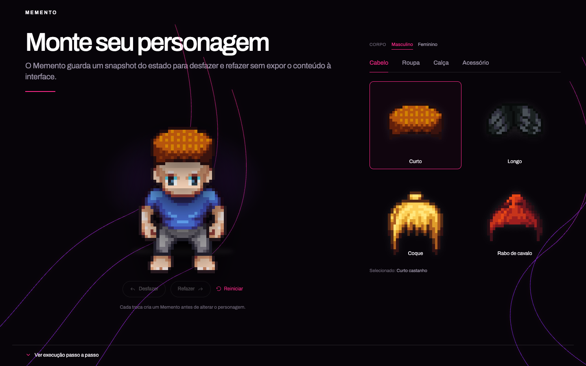

# Memento — ateliê de personagem



**No ar:** <https://marianamarques01.github.io/atelie-do-memento/> — abre direto no navegador, sem instalar nada.

Aplicação web didática sobre o padrão de projeto **Memento**. A tela principal é um ateliê minimalista: personagem grande, personalização por miniaturas, escolha de corpo e controles de desfazer/refazer sempre visíveis. Código, pilhas e explicações ficam recolhidos em **“Ver execução passo a passo”**.

- React + Vite + JavaScript, sem backend.
- Personagem montado com assets reais do **Universal LPC**.
- Escolha de corpo **masculino/feminino**.
- Cabelo, roupa, calça e acessório com 4 opções cada.
- Desfazer/refazer, inclusive para a troca de corpo.
- Roteiro guiado de 26 etapas, aberto em uma apresentação sobre a página.
- Assets locais e créditos por peça.

## Rodar

Requisitos: Node.js 20.19+ (ou 22+) e npm.

```bash
npm install
npm run dev
```

Abra a URL mostrada pelo Vite (por padrão, `http://localhost:5173`).

```bash
npm test        # 17 testes de domínio, cliente e roteiro
npm run build   # build de produção
npm run preview # servir o build
```

Não abra `dist/index.html` diretamente via `file://`: use o dev server ou o preview. O CSS é carregado pelo HTML, então a tela de carregamento aparece estilizada mesmo antes do React montar.

Para regenerar as imagens derivadas (opcional; as imagens já estão versionadas):

```bash
python3 -m pip install Pillow
python3 scripts/preparar_assets.py
```

## A interface

### Tela principal

- **Estética escura e minimalista**, com linhas neon finas, tipografia branca e acento rosa, alinhada ao slide de referência.
- **Personagem grande** com halo discreto e sem moldura pesada.
- **Corpo:** alterna entre as bases masculina e feminina reais do ULPC.
- **Categorias:** Cabelo, Roupa, Calça e Acessório.
- **Miniaturas:** recortes da própria peça LPC, não desenhos novos.
- **Desfazer / Refazer / Reiniciar:** sempre acessíveis sob o personagem.
- **Ver execução passo a passo:** abre a apresentação didática no rodapé.

Cada troca efetiva cria um Memento com o estado anterior. Repetir a peça atual não cria entrada. Trocar o corpo também é uma alteração de estado e entra no histórico.

### Execução passo a passo

O botão abre uma sobreposição com:

- o personagem do roteiro, o estado interno e as pilhas;
- a frase da etapa, curta, para ler em voz alta;
- o código da chamada, com arquivo, método e linha executada em destaque;
- o botão **Próxima etapa** (ou a tecla → / espaço), que executa uma chamada real por vez.
- a caixa **Fim do roteiro**, com o estado final e o refazer vazio.

Os controles de personalização não aparecem nessa camada. Ao fechar, o ateliê livre continua no estado em que estava.

## O padrão no código

| Participante | Arquivo | Papel |
| --- | --- | --- |
| **Personagem / Originator** | [`src/dominio/Personagem.js`](src/dominio/Personagem.js) | Mantém o estado privado, cria Mementos e restaura snapshots. |
| **Memento** | [`src/dominio/Personagem.js`](src/dominio/Personagem.js) | Objeto opaco; o snapshot fica em um `WeakMap` privado do módulo. |
| **Histórico / Caretaker** | [`src/dominio/Historico.js`](src/dominio/Historico.js) | Duas pilhas privadas, `#desfazer` e `#refazer`. |
| **Cliente / Interface** | [`src/cliente/sessao.js`](src/cliente/sessao.js) e [`src/App.jsx`](src/App.jsx) | Decide quando chamar cada método e atualiza a tela. |

```js
const estado = {
  genero: "masculino",
  cabelo: "curto-castanho",
  camisa: "azul",
  calca: "cinza",
  acessorio: "nenhum",
};
```

O estado guarda apenas **identificadores**. A imagem não é salva em cada Memento; o personagem é composto por `` em camadas na ordem de `zPos` do ULPC.

### Cópia rasa

Todos os valores são strings. Por isso, `{ ...this.#estado }` já cria um snapshot independente: não há objetos aninhados compartilhados. Ao restaurar, uma nova cópia é atribuída ao estado vivo. O comentário está no código.

### Regras implementadas

- **Nova alteração:** captura o estado atual, guarda o Memento no desfazer, limpa o refazer e aplica a troca.
- **Desfazer:** captura o atual para o refazer, recupera o topo do desfazer e restaura.
- **Refazer:** captura o atual para o desfazer, recupera o topo do refazer e restaura.
- **Pilhas vazias:** retornam resultado seguro, sem lançar erro.
- **Primeira alteração:** é desfazível porque o estado inicial é salvo antes da troca.
- **Peça repetida:** é um no-op; não cria Memento.
- **Gênero:** é parte do estado e do snapshot; desfazer volta também o corpo anterior.
- **Histórico:** mostra número e rótulo separados; nunca lê o conteúdo do Memento.

## Roteiro guiado

O roteiro fica em [`src/interface/roteiro.js`](src/interface/roteiro.js) e é executado por [`src/interface/useSessoes.js`](src/interface/useSessoes.js). São 26 etapas reais:

1. Captura e guarda o Memento do cabelo curto.
2. Aplica cabelo longo.
3. Captura e guarda o Memento da camisa azul.
4. Aplica camisa roxa.
5. Desfaz a camisa.
6. Desfaz o cabelo.
7. Refaz o cabelo.
8. Aplica uma calça verde como nova edição; o refazer é limpo.

A primeira troca é dividida em seis momentos:

1. A interface pede a foto (`criarMemento()` no cliente).
2. O Personagem tira a foto (cópia no `WeakMap` privado).
3. A foto vai para o Histórico, com um rótulo à parte.
4. O Histórico empilha no desfazer e limpa o refazer.
5. Troca a peça; a tela ainda mostra o desenho anterior.
6. A interface redesenha com `obterAparencia()`.

### Roteiro curto de apresentação

1. Mostre o ateliê: personagem, escolha de corpo, peças e desfazer/refazer.
2. Troque a roupa, desfaça e refaça. Diga que cada troca efetiva cria um Memento.
3. Troque o corpo para feminino e desfaça. O gênero também faz parte do snapshot.
4. Clique em **Ver execução passo a passo**.
5. Avance uma etapa por vez e leia a frase em voz alta; o código mostra a chamada real.
6. Na etapa 5 da primeira troca, mostre o palco aguardando o desenho; na 6, o redesenho.
7. Continue até o fim e mostre o refazer vazio com **“limpa pela nova edição”**.
8. Feche a apresentação, que volta ao ateliê livre.

Roteiro detalhado: [`docs/ROTEIRO-APRESENTACAO.md`](docs/ROTEIRO-APRESENTACAO.md).

## Assets do Universal LPC

- Fonte inspecionada: repositório oficial do Universal LPC (commit `86160e750`).
- Cada `idle.png` tem **128×256 px**, em **2 colunas × 4 linhas** de frames **64×64**.
- A ordem das linhas é `up`, `left`, `down`, `right`.
- O frame frontal usado é `down` (índice 2, `y=128`), primeira coluna (`x=0`).
- Sheets originais preservados em `public/assets/lpc/originais/`.
- Recortes finais em `public/assets/lpc/frente/`; miniaturas em `public/assets/lpc/miniaturas/`.
- Renderização com `image-rendering: pixelated`.

### Peças e licenças

| Uso | Origem | Licença usada |
| --- | --- | --- |
| Corpo masculino | `body/bodies/male/idle.png` | OGA-BY 3.0 |
| Corpo feminino | `body/bodies/female/idle.png` | OGA-BY 3.0 |
| Cabeças | `head/heads/human/{male,female}/idle.png` | OGA-BY 3.0 |
| Expressões neutras | `head/faces/{male,female}/neutral/idle.png` | OGA-BY 3.0 |
| Cabelo curto | `hair/flat_top_fade/adult/idle.png` | CC0 |
| Cabelo longo | `hair/long_straight/adult/idle.png` | CC0 |
| Coque | `hair/bangs_bun/adult/idle.png` | CC0 |
| Rabo de cavalo | `hair/high_ponytail/adult/fg/idle.png` | OGA-BY 3.0 |
| Camisas | `torso/clothes/shortsleeve/tshirt/{male,female}/idle.png` | OGA-BY 3.0 |
| Calças | `legs/pants/{male,thin}/idle.png` | OGA-BY 3.0 |
| Óculos | `facial/glasses/glasses/adult/idle.png` | OGA-BY 3.0 |
| Faixa | `hat/headband/thick/adult/idle.png` | OGA-BY 3.0+ |
| Brinco | `facial/earrings/simple/left/adult/idle.png` | CC0 |

As licenças **não são iguais**. Alguns arquivos oferecem mais de uma opção (por exemplo, corpos e calças também têm CC-BY-SA/GPL); esta aplicação usa as opções OGA-BY/CC0 da tabela. Autoria completa, URLs e modificações estão em [`docs/CREDITOS-ASSETS.md`](docs/CREDITOS-ASSETS.md), no modal **Créditos** e em `public/assets/lpc/CREDITOS.md`.

Textos locais: `public/licencas/OGA-BY-3.0.txt`, `public/licencas/CC0-1.0.txt` e as licenças OFL das fontes. As fontes Archivo e IBM Plex Mono são OFL 1.1 e estão empacotadas localmente.

## Estrutura

```text
src/
  dominio/
    Personagem.js       Personagem + Memento + WeakMap privado
    Historico.js        Caretaker com duas pilhas privadas
  cliente/
    sessao.js           coordenação das chamadas e das trocas de gênero
  interface/
    roteiro.js          conteúdo e sequência do passo a passo
    useSessoes.js       sessões React, operações reais e roteiro
  dados/
    pecas.js            catálogo, gêneros, camadas e miniaturas
    creditos.js         atribuições por peça
  componentes/
    PainelLivre.jsx     personalização minimalista
    SpritePersonagem.jsx
    ModoApresentacao.jsx
    PainelGuiado.jsx
    ModalCreditos.jsx
tests/
  memento.test.js       snapshots, gênero, pilhas e fluxo completo
  roteiro.test.js       estrutura do passo a passo
scripts/
  preparar_assets.py    recorte, recolorização e miniaturas
```

## Testes

`npm test` executa **17 testes**:

- snapshot independente do estado vivo;
- gênero incluído no snapshot e restaurado;
- `obterAparencia()` devolve cópia;
- Memento opaco (`Object.keys` vazio, JSON `{}`);
- Memento inválido e gênero inválido rejeitados;
- Histórico guarda/devolve Mementos e não expõe estado na visão;
- pilhas vazias sem erro;
- primeira troca desfazível;
- peça repetida sem entrada;
- desfazer/refazer;
- troca de corpo desfazível;
- nova edição limpa o refazer;
- roteiro completo da apresentação;
- estrutura das 26 etapas.

## Limitações reais

- Pose **estática e frontal**: apenas o primeiro frame de idle da direção `down`.
- Coleção curada: não incorpora todas as centenas de peças do ULPC.
- Cores pré-calculadas com as paletas ULPC; não há editor de cor em tempo real.
- O asset `legs/pants` cobre o quadril/parte superior das pernas no frame frontal; a geometria original foi mantida.
- O roteiro de apresentação usa uma sessão própria, começando no estado base masculino; o ateliê livre mantém outra sessão. Ao fechar a apresentação, o ateliê volta ao estado livre anterior.
- Sem persistência após recarregar a página.
- Layout validado em desktop e responsivo; pensado para projetor.

## Licença

Código sob MIT (`LICENSE`). Artes e fontes mantêm suas licenças originais. O código do gerador Universal LPC não foi incorporado.
